<div align="center">



<br/>

<a href="https://k8s.adailsilva.com.br"></a>
<a href="https://linkedin.com/in/adailsilva"></a>


</div>



## 📡 Sobre mim

```c
// Uplink #1 — perfil do operador
struct Operador {
    const char *nome     = "Adail Silva";
    const char *base     = "Tianguá, Ceará — Brasil";
    const char *regiao   = "AU915 · sub-banda 1";
    const char *missao   = "Da Sua Ideia ao Kubernetes";
    const char *foco[]   = { "LoRaWAN", "Firmware ESP32/STM32", "Gateways multicanal",
                             "ChirpStack", "Kubernetes ARM64", "Full Stack" };
};
```

- 🛰️ Projeto e opero **redes LoRaWAN** de ponta a ponta: do nó com sensor ao Network Server rodando em Kubernetes.
- 🔧 Escrevo **firmware em C/C++** para ESP32 e STM32 — nós ABP/OTAA e gateways de 8 canais com SX1301 e SX1302 sem Raspberry Pi.
- ☁️ Mantenho um **cluster Kubernetes ARM64 na OCI Always Free** que hospeda o ChirpStack e meus sistemas.
- 💻 Desenvolvo sistemas **Java/Spring, Angular e Flutter** que consomem a telemetria e viram produto.
- 📶 Na área de TI desde 2007 — suporte, redes, NOC e, hoje, IoT e desenvolvimento.





## 🔭 Projetos em destaque

### 📶 Gateways multicanal (sem Raspberry Pi)

| Projeto | O que faz |
|---|---|
| [**Gateway_ESP32_SX1302_LR1302_HAT_Elecrow**](https://github.com/AdailSilva/Gateway_ESP32_SX1302_LR1302_HAT_Elecrow) | Gateway LoRaWAN de 8 canais e baixo custo, com o SX1302_HAL v2.1.0 rodando nativo em um único ESP32. |
| [**Gateway_ESP32_SX1301_RD43HATGPS_Radioenge**](https://github.com/AdailSilva/Gateway_ESP32_SX1301_RD43HATGPS_Radioenge) | Gateway LoRaWAN de 8 canais com o HAL do SX1301 (lora_gateway v5.0.1) portado para um único ESP32. |

### 📟 Nós LoRaWAN (end devices)

| Projeto | O que faz |
|---|---|
| [**Node_STM32_SX1272_RD49C_Radioenge_ABP_e_OTAA**](https://github.com/AdailSilva/Node_STM32_SX1272_RD49C_Radioenge_ABP_e_OTAA) | Firmware para o módulo Radioenge EndDevice (STM32L071CZ + SX1272): ABP e OTAA num só firmware, classes A/B/C, LoRaMac-node v4.7.1 e o conjunto completo de comandos AT. |
| [**Node_ESP32_SX1276_RFM95W_HOPERF_OTAA**](https://github.com/AdailSilva/Node_ESP32_SX1276_RFM95W_HOPERF_OTAA) | Nó OTAA ESP32 + RFM95W em AU915 com ChirpStack v4, página web e app Android — ESP-IDF e MCCI LMiC 6.0.1. |
| [**Node_ESP32_SX1276_RFM95W_HOPERF_ABP**](https://github.com/AdailSilva/Node_ESP32_SX1276_RFM95W_HOPERF_ABP) | Nó ABP ESP32 + RFM95W em AU915 com ChirpStack v4, página web e app Android — ESP-IDF e MCCI LMiC 3.3.0. |
| [**esp32-lorawan-otaa-au915-chirpstack**](https://github.com/AdailSilva/esp32-lorawan-otaa-au915-chirpstack) | Versão Arduino do nó OTAA (LMiC 6.0.1, sub-banda 1), com chave de sessão pós-JOIN, diagnóstico de MIC e depuração completa. |
| [**esp32-lorawan-abp-au915-chirpstack**](https://github.com/AdailSilva/esp32-lorawan-abp-au915-chirpstack) | Versão Arduino do nó ABP (LMiC 3.3.0, sub-banda 1), com contador de frames persistido em NVS e diagnóstico de MIC. |

### ☁️ Network Server na nuvem

| Projeto | O que faz |
|---|---|
| [**k8s-arm-oci-chirpstack**](https://github.com/AdailSilva/k8s-arm-oci-chirpstack) | ChirpStack LoRaWAN (v3 e v4) implantado em cluster Kubernetes ARM na OCI Always Free. |

### 📚 Documentação

| Projeto | O que faz |
|---|---|
| [**DocsEverynet_pt-BR**](https://github.com/AdailSilva/DocsEverynet_pt-BR) | Documentação da Everynet traduzida para o português brasileiro. |



## 🧰 Stack

<div align="center">

**Rádio & Embarcados**


<br/><br/>


<br/><br/>

**Backend, Frontend & Mobile**


<br/><br/>

**Cloud & DevOps**


</div>


<div align="center">

```
>>> downlink: obrigado pela visita!  ACK ✓   73 de AdailSilva
```

</div>
